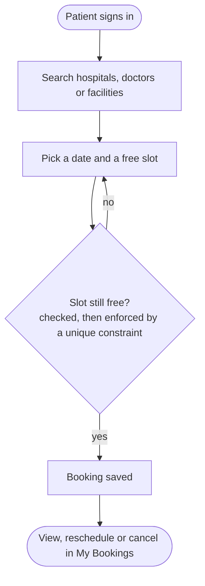

# MediBook: Medical Appointments & Facilities

Flask web app for booking doctor appointments and hospital facility tests such as lab tests and X-rays.
It started as a group final-year project (CS-619) and was then refactored, step by step and test-first, into a
layered application.

## Features

- Browse hospitals, doctors and facilities with search, filters and pagination
- Book a doctor in a free time slot (working days, live availability, past slots blocked) or book a facility test
  with an optional prescription file
- Patients can view, reschedule and cancel their own bookings and see their test results
- Admin dashboard to manage hospitals, doctors, facilities, users, bookings and test results
- Responsive Bootstrap 5 UI with dark mode

## Security

What is implemented:

- **Bookings:** double bookings are prevented by unique constraints in the database, not only by a check in the code
- **Accounts:** scrypt password hashes; at least 8 characters, no common passwords; account lockout after 5 failed
  logins and per-IP rate limiting; no fixed passwords for seeded accounts
- **Sessions:** logout and password changes revoke every copy of the session cookie; 30-minute idle timeout,
  12-hour limit
- **Patient files:** stored outside the web root and served only to the patient and admins
- **Requests and browser:** CSRF tokens, data changes only by POST, Content-Security-Policy with nonce,
  Subresource Integrity for CDN files, HSTS over HTTPS
- **Data:** hospitals, doctors, facilities and users are archived, never deleted, so booking history is kept

## How it works



## Tech stack

Python · Flask · SQLAlchemy · Flask-WTF · Flask-Limiter · Bootstrap 5 · SQLite or MySQL

## Quick start (Windows)

```bat
git clone https://github.com/Faizan-Ali-code/Medical-Appointment-and-Facilities.git
cd Medical-Appointment-and-Facilities
setup.bat
run.bat
```

Open http://127.0.0.1:5000. `setup.bat` creates a virtual environment, a `.env` file with a random `SECRET_KEY`,
a local SQLite database and demo data (20 hospitals, 40 doctors, 24 facilities). It prints the sample logins
(an admin, a patient and six demo patients) with passwords generated for your installation.

To use MySQL instead of SQLite, create an empty database, set `DATABASE_URL` in `.env` (see `.env.example`) and run
`setup.bat`. To update an existing database after pulling new code, run `venv\Scripts\flask --app run upgrade-db`.

## Project structure

```
app/
  blueprints/   pages and routes (public, auth, account, bookings, admin)
  services/     search and booking rules
  utils/        sessions, passwords, uploads, time slots
  models.py     database models
  migrations.py upgrades existing databases
  templates/    HTML pages
  static/       CSS, JavaScript and public images
run.py          local development server
wsgi.py         production entry point
setup.bat       one-time setup
run.bat         starts the app
```
