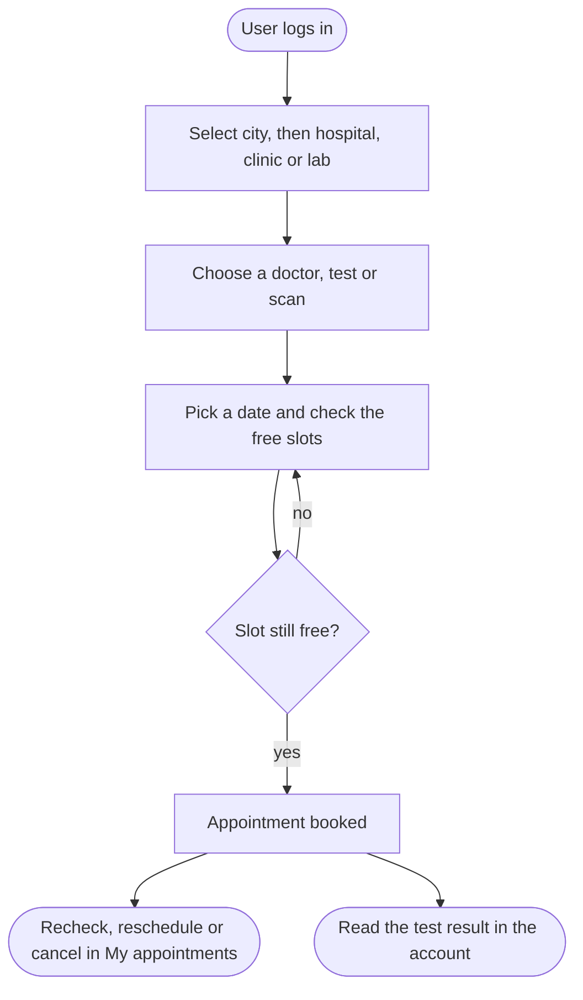

# MediBook: Medical Appointments & Facilities

A web application for booking doctors, lab tests and scans. A user selects a city, then a hospital, clinic or
laboratory, then a doctor or facility, checks the free time slots and books one. An administrator manages
everything the users see.

## Features

**Users**

- Register and log in
- Select a city, then a hospital, clinic or laboratory, then a doctor or facility
- Search by city, hospital name, type of service or specialist name
- See each doctor's timings and fee, and each place's timings, location and other facilities
- Check the free slots of a doctor, test or scan for any date before booking
- Book a consultant or specialist, a pathology or paramedical test, or a radiology scan
- Recheck the date and time of an appointment, reschedule it, or cancel it so that the slot becomes free again
- Read test results in the account

**Administrators**

- Manage cities
- Manage hospitals, clinics and laboratories with their timings, location and other facilities
- Manage specialists with their fee, working days and hours
- Manage the facilities of each hospital or lab
- Manage users and admin accounts
- Manage appointments: search and filter, reschedule, cancel, mark as completed and enter test results

A record with upcoming appointments (a user, doctor, facility or hospital) cannot be deleted until those
appointments are cancelled or moved.

## How booking works



A slot is free when it lies on a working day of the doctor or facility, has not started yet and holds no
appointment. The check runs when the slots are shown and again when the booking is saved, and a unique
constraint in the database makes sure that two people can never get the same slot.

## Security

Passwords are stored only as salted scrypt hashes. Every form carries a CSRF token, data changes only by POST,
all database queries use bound parameters, and all output is escaped.

## Tech stack

Python · Flask · SQLAlchemy · Flask-WTF · Bootstrap 5 · SQLite or MySQL

## Quick start (Windows)

```bat
git clone https://github.com/Faizan-Ali-code/Medical-Appointment-and-Facilities.git
cd Medical-Appointment-and-Facilities
setup.bat
run.bat
```

Open http://127.0.0.1:5000. `setup.bat` creates a virtual environment, installs the packages and creates a local
SQLite database with sample data: 8 cities, 18 hospitals, clinics and labs, 40 doctors and their facilities.
All sample names, addresses and phone numbers are made up.

| Sample login | Email | Password |
|---|---|---|
| Administrator | `admin@medibook.test` | `admin123` |
| User | `patient@medibook.test` | `patient123` |

To use MySQL instead of SQLite, create an empty database, set `DATABASE_URL` in `.env` (see `.env.example`) and
run `setup.bat`. To start again from the sample data, run `venv\Scripts\flask --app run init-db --reset`.

## Project structure

```
app/
  blueprints/   pages: public, auth, account (users) and admin
  services/     booking rules, search queries and dashboard numbers
  utils/        login session, time slots, pictures
  models.py     database tables
  forms.py      forms and their validation
  seed.py       database setup and sample data
  templates/    HTML pages
  static/       CSS, JavaScript and icon
run.py          starts the app
setup.bat       one-time setup
run.bat         starts the app after setup
```
