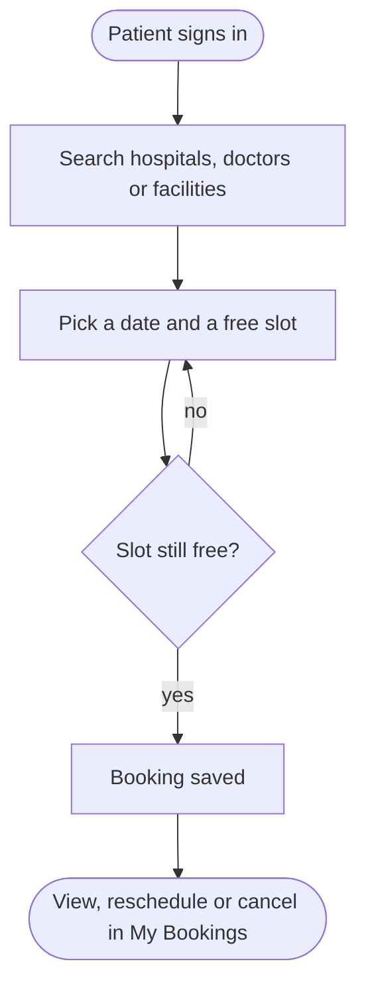

# MediBook: Medical Appointments & Facilities

Flask web app for booking doctor appointments and hospital facility tests such as lab tests and X-rays. Built as a final-year project (CS-619), then refactored into a layered app with security hardening.

## Features

- Browse hospitals, doctors and facilities with search, filters and pagination
- Book a doctor in a free time slot (working days, live availability) or book a facility test
- Patients can view, reschedule and cancel their own bookings
- Admin dashboard to manage hospitals, doctors, facilities, users and all bookings
- Security: hashed passwords, CSRF protection, role checks, safe image uploads and security headers
- Responsive Bootstrap 5 UI with dark mode

## How it works



## Tech stack

Python · Flask · SQLAlchemy · Flask-WTF · Bootstrap 5 · SQLite or MySQL

## Quick start (Windows)

```bat
git clone https://github.com/Faizan-Ali-code/Medical-Appointment-and-Facilities.git
cd Medical-Appointment-and-Facilities
setup.bat
run.bat
```

Open http://127.0.0.1:5000. `setup.bat` creates a virtual environment, a local SQLite database and demo data (20 hospitals, 40 doctors, 24 facilities).

| Role | Email | Password |
| --- | --- | --- |
| Admin | admin@yahoo.com | admin |
| Patient | user@yahoo.com | user |

To use MySQL instead of SQLite, create an empty database, set `DATABASE_URL` in `.env` (see `.env.example`) and run `setup.bat`.

## Project structure

```
app/
  blueprints/   pages and routes (public, auth, account, bookings, admin)
  services/     search and booking rules
  models.py     database models
  templates/    HTML pages
  static/       CSS, JavaScript and images
run.py          starts the server
setup.bat       one-time setup
run.bat         starts the app
```
